 
 

<h2>👋 About</h2>

I started in **backend development**, building APIs and services, then explored vulnerability research and weapon-system anti-tampering at the **Defense Security Lab**.

At **Melcon**, I develop firmware for semiconductor equipment, working with schematics, UART/USART communication, and GPIO and peripheral control.

I’m growing as an **embedded software engineer**, focused on equipment control and interested in defense systems and drones.

<h2>🛠️ Technical Skills</h2>

**Languages**  

**Embedded Systems**  

**Security**  

**Other Frameworks**  

**Databases**

**Tools**

<h2>💼 Experience</h2>

### Melcon
**Embedded Software Engineer Intern** · Mar 2026 – Present

- Develop firmware for semiconductor equipment based on hardware schematics and communication specifications.
- Implement UART/USART initialization and data handling, and configure GPIO and peripherals.

### Defense Security Lab
**Researcher** · Apr 2025 – Feb 2026

- Evaluated the impact of anti-tampering measures on weapon systems as part of a LIG Nex1 project.
- Conducted MCP vulnerability research; published and presented the findings at the Korean Institute of Defense Technology.
- Contributed to the development of a CMMC compliance tool.

### MJSEC
**Backend Mentor · Security Club Member** · Dec 2024 – Mar 2026

- Mentored backend developers and contributed to CTF and assignment-management platforms.
- Studied web security and reverse engineering.

<strong>Education & Training</strong>

**Zero-Base · Backend Development Bootcamp**  
Nov 2023 – Jul 2024  
Projects included parking information, table reservations, public Wi-Fi information, and a one-day class platform.

**Computer Engineering**  
Began university studies in Mar 2020.

<h2 align="center">✉️ Contact</h2>

